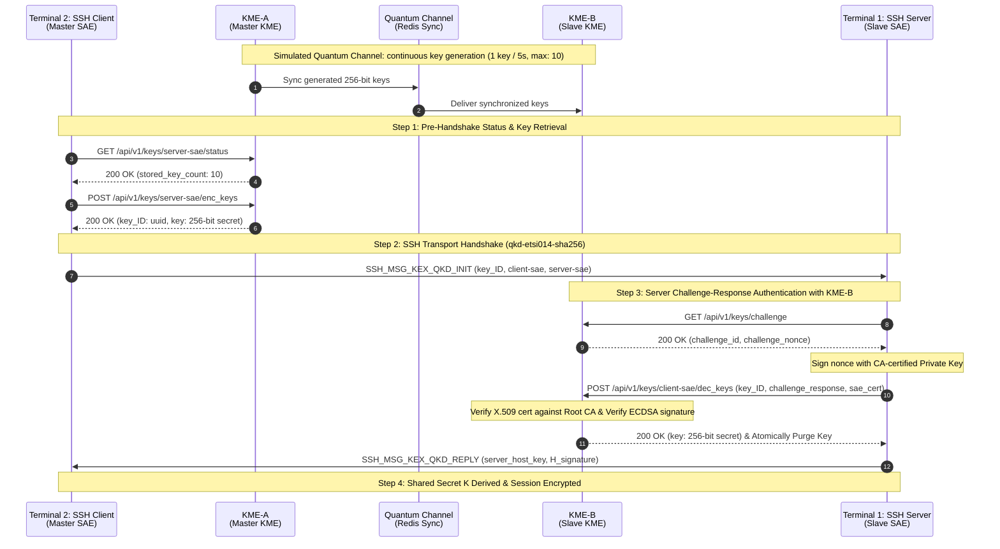

# ETSI GS QKD 014 Quantum Key Distribution for SSH (Paramiko)
## 2-Terminal Live Demonstration & Project Evaluation Guide

---

## 📌 Executive Summary

This project integrates the **ETSI GS QKD 014** (Quantum Key Distribution: Application Interface) REST specification into the SSH transport protocol using an upgraded **Paramiko** library.

Instead of classical asymmetric key exchange (Diffie-Hellman / ECDH) which is vulnerable to quantum computers running Shor's algorithm, the SSH transport establishes a shared symmetric root secret $K$ derived from local Quantum Key Management Entities (**KME-A** and **KME-B**), backed by PKI challenge-response authentication and automatic graceful fallback.

---

## 🏛️ System Architecture



---

## 🖥️ Demonstration Setup: The 2-Terminal Workflow

Only **two terminals** are needed:

```
┌──────────────────────────────────────────────┬──────────────────────────────────────────────┐
│  TERMINAL 1: Real-Time Live Server & KME Logs │  TERMINAL 2: Interactive Presenter Terminal  │
│                                              │                                              │
│  $ cd docker                                 │  $ cd docker                                 │
│  $ docker compose up                         │  $ docker compose run --rm client            │
│                                              │                                              │
│  Streams real-time color-coded logs:         │  Runs the QKD-secured SSH client, shows      │
│  • KME-A: Incoming REST calls & delivered key│  handshake negotiation and executes commands │
│  • KME-B: Challenge nonces, PKI validation,  │                                              │
│    and one-time key consumption via GETDEL   │  Or test automatic fallback:                 │
│  • Server: Verbose Paramiko DEBUG packets    │  $ docker compose run --no-deps --rm         │
│    (KEXINIT, QKD_INIT, NEWKEYS, AUTH, EXEC)  │    -e QKD_MIN_AVAILABLE_KEYS=20 client      │
└──────────────────────────────────────────────┴──────────────────────────────────────────────┘
```

---

## 🎬 Step-by-Step Live Demonstration

### 1. Terminal 1: Start All Services & Stream Real-Time Logs

In your first terminal:

```bash
cd /home/kanishk/data/BTP/Implementation/docker
docker compose up
```

> **What happens:**
> - `ca` initializes the Root CA, generates X.509 certificates and SSH host keys, then cleanly exits.
> - `redis`, `kme-a`, `kme-b`, and `server` start in the foreground.
> - `client` is registered under the `client` profile, so it will wait until you trigger it from Terminal 2.
> - Terminal 1 now streams real-time, color-coded logs for all components.

---

### 2. Terminal 2 (Demonstration Part A): Standard QKD-Secured SSH Connection

In your second terminal:

```bash
cd /home/kanishk/data/BTP/Implementation/docker
docker compose run --rm client
```

#### What You Will See in Terminal 2 (Client):
```text
==================================================
      Connecting via QKD-secured Paramiko SSH     
 Target Host: server:2222
 Master SAE ID (Username): client-sae
 Slave SAE ID (Target):   server-sae
 Client KME URL:          http://kme-a:8000
 Min Key Pool Threshold:  2
==================================================
[DEBUG] kex algos: qkd-etsi014-sha256, mlkem768x25519-sha256, curve25519-sha256...
[DEBUG] Strict kex mode: True
[DEBUG] Kex: qkd-etsi014-sha256
[DEBUG] QKD: Retrieved quantum key b89b92fd... from KME-A (http://kme-a:8000)
[DEBUG] QKD: Sending SSH_MSG_KEX_QKD_INIT (key_ID=b89b92fd-..., master=client-sae, slave=server-sae)
[DEBUG] Switch to new keys ...
[INFO] Authentication (password) successful!

[SUCCESS] Successfully connected!
[SECURITY] Key Exchange Algorithm Negotiated: qkd-etsi014-sha256
[STATUS] Connection is Quantum Key Distribution (QKD) SECURED! 🛡️

--- Command Output ---
Linux ... x86_64 GNU/Linux
QKD SSH Session Verification OK

[INFO] SSH connection closed cleanly.
```

#### What Lights Up in Terminal 1 (Real-Time Infrastructure Logs):
Show the panel the simultaneous log stream in Terminal 1:

1. **KME-A Status & Key Delivery**:
   ```text
   kme-a-1  | [KME-A] >>> GET /api/v1/keys/server-sae/status (from 172.21.0.6)
   kme-a-1  | [KME-A] <<< 200 OK /api/v1/keys/server-sae/status | Response: {"stored_key_count": 10, ...}
   kme-a-1  | [KME-A] >>> POST /api/v1/keys/server-sae/enc_keys (from 172.21.0.6) | Payload: {"number": 1, "size": 256}
   kme-a-1  | [KME-A] Pop/Deliver key b89b92fd... to server-sae | Remaining in pool: 9/10
   kme-a-1  | [KME-A] <<< 200 OK /api/v1/keys/server-sae/enc_keys | Response: {"keys": [{"key_ID": "b89b92fd...", "key": "<256-bit secret>"}]}
   ```

2. **Server Handshake & KME-B Challenge-Response Authentication**:
   ```text
   server-1 | [DEBUG] Kex: qkd-etsi014-sha256
   server-1 | [DEBUG] QKD: Server received SSH_MSG_KEX_QKD_INIT (key_ID=b89b92fd-..., master=client-sae, slave=server-sae)
   server-1 | [DEBUG] QKD: Requesting challenge and fetching key material from KME-B...
   kme-b-1  | [KME-B] >>> GET /api/v1/keys/challenge (from 172.21.0.5)
   kme-b-1  | [KME-B] <<< 200 OK /api/v1/keys/challenge | Response: {"challenge_id": "c6a5a990...", "challenge": "..."}
   kme-b-1  | [KME-B] >>> POST /api/v1/keys/client-sae/dec_keys | Payload: {"key_IDs": ["b89b92fd..."], "challenge_response": "<Signature ...>", "sae_cert": "<X.509 PEM>"}
   kme-b-1  | [KME-B] Challenge verified for client-sae. Key b89b92fd... permanently consumed and deleted from storage.
   server-1 | [DEBUG] QKD: Successfully retrieved & verified quantum key from KME-B (256 bits)
   server-1 | [DEBUG] QKD: Computing exchange hash H and sending SSH_MSG_KEX_QKD_REPLY...
   server-1 | [DEBUG] Switch to new keys ...
   server-1 | [AUTH] User 'client-sae' authenticated successfully via password.
   server-1 | [EXEC] Executing command: uname -a && echo 'QKD SSH Session Verification OK'
   ```

3. **Background Optical Key Replenishment**:
   ```text
   kme-a-1  | [QKD-REFILL] + Generated key 2f54ed7f... | Pool size: 10/10 (refill interval: 5.0s)
   ```

👉 **Talking Points for Evaluators:**
- The key was never computed via mathematical assumptions (like discrete logs) or sent over the classical network.
- Both ends fetched the identical 256-bit symmetric key from their respective local KMEs.
- The key was **atomically consumed and permanently destroyed (`GETDEL`)** upon handshake completion.

---

### 3. Terminal 2 (Demonstration Part B): Graceful Fallback Demonstration

A common question from evaluators is: *"What happens if the quantum channel is jammed or the key pool is depleted?"*

In **Terminal 2**, run the client with a minimum pool requirement of 20 keys (when pool capacity is 10):

```bash
docker compose run --no-deps --rm -e QKD_MIN_AVAILABLE_KEYS=20 client
```

#### What You Will See in Terminal 2 (Client):
```text
==================================================
      Connecting via QKD-secured Paramiko SSH     
 Target Host: server:2222
 Master SAE ID (Username): client-sae
 Slave SAE ID (Target):   server-sae
 Client KME URL:          http://kme-a:8000
 Min Key Pool Threshold:  20
==================================================
[WARNING] [QKD] Key pool has 10 key(s) (min threshold: 20) — falling back to classical key exchange
[DEBUG] Kex: mlkem768x25519-sha256
[DEBUG] Switch to new keys ...
[INFO] Authentication (password) successful!

[SUCCESS] Successfully connected!
[SECURITY] Key Exchange Algorithm Negotiated: mlkem768x25519-sha256
[STATUS] Connection fell back to classical key exchange.

--- Command Output ---
Linux ... x86_64 GNU/Linux
QKD SSH Session Verification OK
```

👉 **Talking Points for Evaluators:**
- Prior to handshake initiation, Paramiko queries the ETSI GS QKD 014 status endpoint (`/status`).
- If available keys fall below the configured policy threshold, Paramiko emits a warning and **gracefully falls back** to the next best available algorithm (`mlkem768x25519-sha256` or `curve25519-sha256`).
- The connection completes without interruption, ensuring high availability.

---

## 🔬 Protocol & Cryptographic Specifications

### Custom SSH Messages

| Message Code | Constant Name | Payload Structure |
|---|---|---|
| `30` | `SSH_MSG_KEX_QKD_INIT` | `string key_id`, `string master_sae_id`, `string slave_sae_id` |
| `31` | `SSH_MSG_KEX_QKD_REPLY` | `string server_host_key`, `string signature_of_H` |

### Exchange Hash ($H$) Computation

To bind the session context and prevent Man-in-the-Middle (MITM) attacks, the exchange hash $H$ is computed as:

$$H = \text{SHA-256}(V_C \,\|\, V_S \,\|\, I_C \,\|\, I_S \,\|\, K_S \,\|\, \text{key\_id} \,\|\, K)$$

Where:
- $V_C, V_S$: Client and Server identification strings (e.g. `SSH-2.0-paramiko_5.0.0`).
- $I_C, I_S$: Client and Server `SSH_MSG_KEXINIT` packets.
- $K_S$: Server's public host key.
- $\text{key\_id}$: UUID of the quantum key negotiated via ETSI GS QKD 014.
- $K$: 256-bit symmetric quantum key material treated as the shared secret integer (`mpint`).

---

## 🎓 Oral Defense / Viva Q&A Cheat Sheet

### Q1: Why use QKD over SSH instead of standard Post-Quantum Cryptography (PQC)?
> **Answer:** PQC algorithms (e.g. ML-KEM/Kyber) rely on mathematical complexity assumptions (e.g. Learning With Errors). While resistant to known quantum attacks, their security is computational and not proven unconditionally. QKD relies on the fundamental physics of quantum mechanics (Heisenberg Uncertainty Principle and No-Cloning Theorem), providing **Information-Theoretic Security (ITS)**. Our system provides hybrid resilience: ITS quantum keys when available, with automatic fallback to PQC (`mlkem768x25519-sha256`).

### Q2: What prevents an attacker from intercepting the `key_ID` on the classical network and decrypting the traffic?
> **Answer:** The `key_ID` is merely a reference UUID, not the key material itself. The actual 256-bit key is never sent across the network; it resides only inside KME-A and KME-B. Furthermore, KME-B enforces strict challenge-response authentication: an entity requesting the key for that `key_ID` must prove ownership of a valid X.509 certificate signed by the Root CA by signing a cryptographically fresh nonce. Once delivered, the key is permanently deleted from Redis (`getdel`), preventing replay.

### Q3: How was ETSI GS QKD 014 integrated into Paramiko?
> **Answer:**
> 1. Implemented `paramiko/kex_qkd.py` providing the `KexQKD` class conforming to the Paramiko KEX engine interface.
> 2. Added client & server handlers for SSH message numbers `30` (`SSH_MSG_KEX_QKD_INIT`) and `31` (`SSH_MSG_KEX_QKD_REPLY`).
> 3. Registered `qkd-etsi014-sha256` as the highest priority KEX method in `Transport._preferred_kex`.
> 4. Added proactive status checks and threshold-based fallback in `client.py`.

---

## 🧹 Quick Reset Commands

To stop services and reset all volumes for a clean demonstration:

```bash
cd /home/kanishk/data/BTP/Implementation/docker

# Stop and wipe volume state (cleans certificates and keys)
docker compose down -v
```