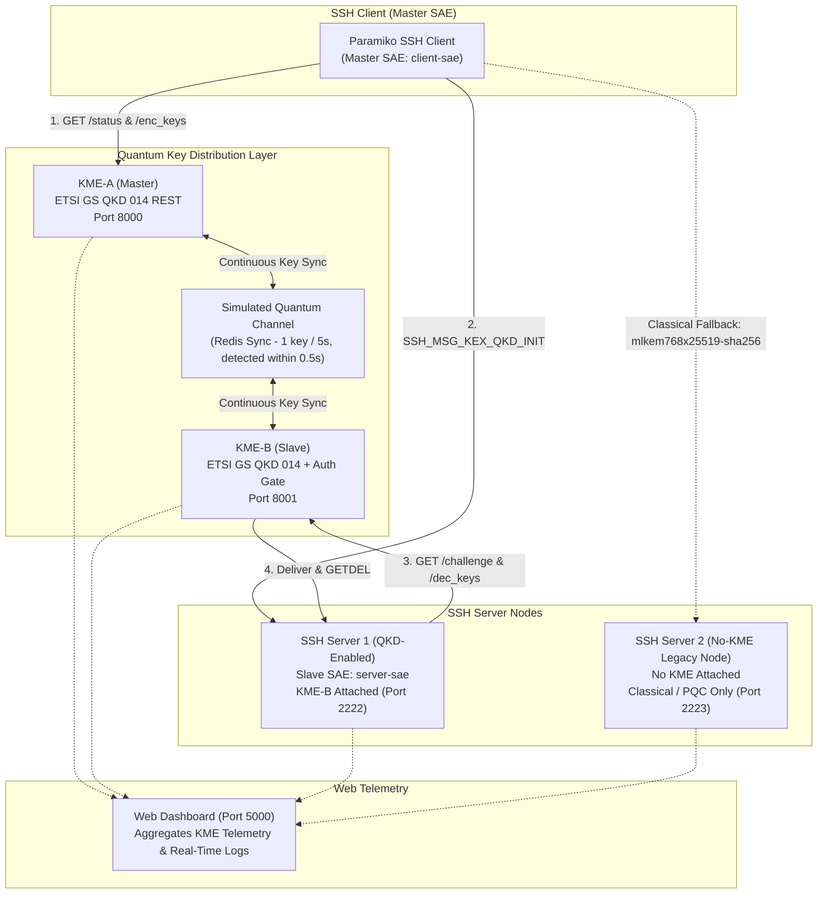

# ETSI GS QKD 014 Quantum Key Distribution for SSH (Paramiko)
## v2 Demonstration Guide: Real-Time Web Dashboard & Heterogeneous Multi-Node Fallback

---

## 📌 Executive Summary

This project integrates the **ETSI GS QKD 014** (Quantum Key Distribution: Application Interface) REST specification into the SSH transport protocol using an upgraded **Paramiko** library.

In this **v2 architecture**, we introduce:
1. **Interactive Real-Time Web Dashboard** (`http://localhost:5000`): Visualizes live key pool meters, KME-A & KME-B individual telemetry, security challenge-response rates, and real-time streaming protocol logs.
2. **Heterogeneous Network Support**: Demonstrates how QKD-capable clients interact with both **QKD-enabled nodes** (`server`) and **legacy/classical nodes without a KME** (`server2`), showing seamless protocol-level fallback without dropping connections.

---

## 🏛️ System Architecture



---

## 🖥️ Demonstration Workflow

You can run the demonstration using **the Web Dashboard alongside your terminal sessions**:

```
┌───────────────────────────────────────┬────────────────────────────────────────────────────────┐
│  🌐 WEB BROWSER: Live Web Dashboard    │  💻 TERMINALS: Commands & Live Logs                   │
│                                       │                                                        │
│  http://localhost:5000                │  Terminal 1: $ cd docker && docker compose up          │
│                                       │  (Streams background logs for all services)            │
│  • Visual 10-slot Quantum Key Pool    │                                                        │
│  • KME-A (Master) telemetry & logs    │  Terminal 2: Interactive Commands:                     │
│  • KME-B (Slave) security gate logs   │  1. QKD Connection:                                    │
│  • Node status (Server 1 vs Server 2) │     $ docker compose run --rm client                   │
│                                       │  2. Classical Node Fallback (No KME):                  │
│                                       │     $ docker compose run --rm client-server2           │
│                                       │  3. Key Exhaustion Fallback:                           │
│                                       │     $ docker compose run --no-deps --rm                │
│                                       │       -e QKD_MIN_AVAILABLE_KEYS=20 client              │
└───────────────────────────────────────┴────────────────────────────────────────────────────────┘
```

---

## 🎬 Step-by-Step Live Demonstration Script

### Step 1: Start Infrastructure & Open Dashboard

In **Terminal 1**:

```bash
cd /home/kanishk/data/BTP/Implementation/docker
docker compose up
```

Open your browser to:
👉 **`http://localhost:5000`**

**What to highlight on screen:**
- **System Overview Tab**:
  - Live node indicators showing `Server 1 (QKD-Enabled)` and `Server 2 (No-KME Fallback Node)`.
  - The **Quantum Key Pool Meter** glowing with 10 available 256-bit keys.
- **KME-A Tab**:
  - ETSI GS QKD 014 parameters (`source_KME_ID: KME-A`, `target_KME_ID: KME-B`, `key_size: 256`).
- **KME-B Tab**:
  - Security gate metrics (Challenges Issued, Signatures Verified, Keys Consumed via `GETDEL`).

---

### Step 2: Test 1 — Quantum-Secured SSH Connection (Server 1)

In **Terminal 2**, run:

```bash
docker compose run --rm client
```

#### Terminal 2 Output:
```text
==================================================
      Connecting via QKD-secured Paramiko SSH     
 Target Host: server:2222
 Master SAE ID (Username): client-sae
 Slave SAE ID (Target):   server-sae
 Client KME URL:          http://kme-a:8000
 Min Key Pool Threshold:  2
==================================================
[DEBUG] Kex: qkd-etsi014-sha256
[DEBUG] QKD: Retrieved quantum key d426b625... from KME-A (http://kme-a:8000)
[DEBUG] QKD: Sending SSH_MSG_KEX_QKD_INIT (key_ID=d426b625-..., master=client-sae, slave=server-sae)
[DEBUG] Switch to new keys ...
[INFO] Authentication (password) successful!

[SUCCESS] Successfully connected!
[SECURITY] Key Exchange Algorithm Negotiated: qkd-etsi014-sha256
[STATUS] Connection is Quantum Key Distribution (QKD) SECURED! 🛡️
         Root secret derived from ETSI GS QKD 014 Quantum Key material.

--- Command Output ---
Linux ... x86_64 GNU/Linux
QKD SSH Session Verification OK
```

#### What to Show in the Dashboard & Terminal 1:
1. **Key Pool Decrement**: Watch Slot 10 change as `stored_key_count` drops from `10` to `9`.
2. **KME-A Log**: Shows `Pop/Deliver key d426b625... to server-sae | Remaining: 9/10`.
3. **KME-B Log**: Shows `Challenge verified for client-sae. Key d426b625... consumed & deleted (one-time-use)`.
4. **Replenishment**: Within ~0.5s the pool drops below capacity, then the refill loop generates a fresh key. The next key won't be generated for another 5 seconds (rate enforced after each generation).

---

### Step 3: Test 2 — Communicating with a Node Without a KME (Server 2)

Evaluators frequently ask: *"What happens if a client connects to a server that doesn't have a QKD link?"*

In **Terminal 2**, run:

```bash
docker compose run --rm client-server2
```

#### Terminal 2 Output:
```text
==================================================
      Connecting via QKD-secured Paramiko SSH     
 Target Host: server2:2222
 Master SAE ID (Username): client-sae
 Slave SAE ID (Target):   server-sae
 Client KME URL:          http://kme-a:8000
 Min Key Pool Threshold:  2
==================================================
[DEBUG] kex algos: mlkem768x25519-sha256, curve25519-sha256@libssh.org, ...
[DEBUG] Kex: mlkem768x25519-sha256
[DEBUG] Switch to new keys ...
[INFO] Authentication (password) successful!

[SUCCESS] Successfully connected!
[SECURITY] Key Exchange Algorithm Negotiated: mlkem768x25519-sha256
[STATUS] Connection fell back to classical/PQC key exchange.
         Target 'server2' does not negotiate QKD or keys were unavailable.
         Successfully established encrypted session using: mlkem768x25519-sha256

--- Command Output ---
Linux ... x86_64 GNU/Linux
QKD SSH Session Verification OK
```

#### What to Explain to the Evaluators:
- **Zero Configuration Burden**: The client did not require manual reconfiguration. It proposed `qkd-etsi014-sha256` first in its algorithm list.
- **Server2 lacks a KME**: Server2 does not offer `qkd-etsi014-sha256` in its `SSH_MSG_KEXINIT`.
- **Standard Protocol Negotiation**: The SSH key exchange negotiation automatically resolved to the next mutually agreed algorithm: **`mlkem768x25519-sha256`** (Post-Quantum ML-KEM/Kyber hybrid) or `curve25519-sha256`.
- **Full Interoperability**: Demonstrates that our upgraded Paramiko is 100% backward-compatible with non-QKD infrastructure!

---

### Step 4: Test 3 — Key Pool Depletion Fallback (Threshold Policy)

What if the target node *has* a KME, but the key pool is temporarily empty or below safety margins?

In **Terminal 2**, run with `QKD_MIN_AVAILABLE_KEYS=20` (pool holds max 10):

```bash
docker compose run --no-deps --rm -e QKD_MIN_AVAILABLE_KEYS=20 client
```

#### Output:
```text
[WARNING] [QKD] Key pool has 10 key(s) (min threshold: 20) — falling back to classical key exchange
[SECURITY] Key Exchange Algorithm Negotiated: mlkem768x25519-sha256
[STATUS] Connection fell back to classical key exchange.
```

**Talking Point:**
- Prior to handshake initiation, Paramiko queries the ETSI GS QKD 014 status endpoint (`/status`).
- If stored keys are below the configured threshold, Paramiko emits a warning and safely negotiates classical/PQC ciphers, preventing handshake timeouts or service disruptions.

---

## 🎓 Oral Defense / Viva Q&A Cheat Sheet (v2 Specific)

### Q1: How does the system distinguish between a QKD server and a non-QKD server?
> **Answer:** Through standard SSH algorithm negotiation (`SSH_MSG_KEXINIT`). The QKD-enabled server registers `qkd-etsi014-sha256` in its `preferred_kex` list because its `qkd_config` is set. The non-QKD server (`server2`) has `qkd_config=None`, which automatically excludes `qkd-etsi014-sha256` from its advertised KEX list. When the client connects, standard RFC 4253 intersection negotiation selects the first mutually supported algorithm (`mlkem768x25519-sha256` or `curve25519-sha256`).

### Q2: Why is the challenge-response authentication necessary at KME-B?
> **Answer:** In ETSI GS QKD 014, KME-A delivers keys to the Master SAE, while KME-B delivers keys to the Slave SAE upon receiving `key_ID`. If KME-B released key material without authentication, any rogue entity that guessed or intercepted a `key_ID` over the network could query KME-B's `/dec_keys` endpoint and steal the quantum key. Our implementation forces the server to prove ownership of a CA-certified private key by signing an ephemeral nonce before KME-B releases the key.

### Q3: How is key forward secrecy guaranteed?
> **Answer:** By enforcing the One-Time-Pad property:
> 1. In KME-A, the key is popped from the available pool upon delivery (`r.lpop`).
> 2. In KME-B, the key is delivered and atomically deleted using Redis `GETDEL`.
> 3. Even if an attacker compromises the server at a later time, past session keys cannot be re-fetched from either KME.

---

## 🧹 Quick Reset Commands

```bash
cd /home/kanishk/data/BTP/Implementation/docker

# Stop and wipe state (clears Redis key pool and CA certificates)
docker compose down -v

# Re-launch all background services and dashboard
docker compose up -d
```
