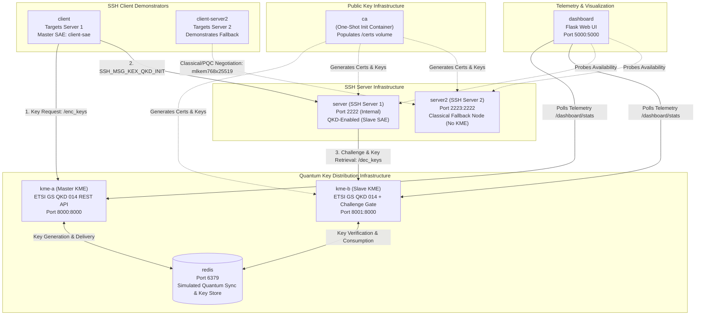

# ETSI GS QKD 014 Quantum Key Distribution for SSH (Paramiko)
## Comprehensive Technical Project Overview & Protocol Specification

---

## 1. Executive Summary

This project integrates the **ETSI GS QKD 014** (*Quantum Key Distribution: Application Interface*) REST standard into the SSHv2 transport layer using an enhanced implementation of the **Paramiko** library.

Traditional SSH key exchange algorithms (such as Diffie-Hellman and Elliptic Curve Diffie-Hellman) rely on computational hardness assumptions (discrete logarithm, elliptic curve discrete logarithm) that are theoretically vulnerable to sufficiently large quantum computers running Shor's algorithm. By integrating Quantum Key Distribution (QKD), key agreement derives its security directly from quantum physical properties (e.g., Heisenberg's uncertainty principle, no-cloning theorem) synchronized between Key Management Entities (KMEs).

### Key Architectural Highlights
1. **ETSI GS QKD 014 Compliance**: Implements the standard key delivery REST API (`/status`, `/enc_keys`, `/dec_keys`) between Secure Application Entities (SAEs) and Key Management Entities (KMEs).
2. **Native Paramiko Integration**: Introduces the custom key exchange identifier `qkd-etsi014-sha256` registered directly into Paramiko's transport layer.
3. **Mutual Challenge-Response Authentication Gate**: Enhances standard ETSI GS QKD 014 with an X.509 CA-based challenge-response authentication protocol at the Slave KME, preventing unauthorized key retrieval.
4. **Heterogeneous Multi-Node Fallback**: Automatically negotiates classical or Post-Quantum Cryptographic (PQC) key exchanges (e.g., `mlkem768x25519-sha256`, `curve25519-sha256`) when connecting to non-QKD servers or when key pool reserves fall below safety thresholds.
5. **Real-Time Web Dashboard**: Flask-based live telemetry monitoring key pools, delivery rates, challenge verifications, node statuses, and streaming log buffers.

---

## 2. System Architecture & Container Roles

The entire infrastructure is containerized using Docker and Docker Compose (`docker/docker-compose.yml`), operating over an isolated bridge network (`qkd-net`).



---

### Detailed Container Catalog

| Container | Base Image / Build Context | Network & Ports | Volumes | Role & Lifecycle |
| :--- | :--- | :--- | :--- | :--- |
| **`ca`** | Custom Alpine / OpenSSL (`docker/ca/Dockerfile`) | None (Internal) | `certs:/certs` | **Certificate Authority**: Runs once upon stack startup (`init.sh`). Generates self-signed Root CA cert/key, server CA-issued identity key/cert for challenge-response auth, and Paramiko SSH host RSA key. |
| **`redis`** | `redis:7-alpine` | `qkd-net:6379` | Anonymous | **Simulated Quantum Link & Key Datastore**: In-memory store representing synchronized quantum channels and key material pools shared between KME-A and KME-B. |
| **`kme-a`** | Python 3.11 / Flask (`docker/kme/Dockerfile`) | `qkd-net`, Host `8000:8000` | None | **Master Key Management Entity**: Serves the Master SAE (SSH Client). Generates 256-bit quantum keys in background (`START_REFILL=true`), pushes to Redis key pool, serves ETSI GS QKD 014 key allocation requests. |
| **`kme-b`** | Python 3.11 / Flask (`docker/kme/Dockerfile`) | `qkd-net`, Host `8001:8000` | `certs:/certs:ro` | **Slave Key Management Entity**: Serves the Slave SAE (SSH Server). Implements cryptographic challenge-response authentication (`ENABLE_CHALLENGE=true`) before retrieving keys via atomic `GETDEL`. |
| **`server`** | Python 3.11 + Paramiko (`docker/server/Dockerfile`) | `qkd-net:2222` | `certs:/certs:ro` | **Primary SSH Server (QKD-Enabled)**: Acts as Slave SAE (`server-sae`). Configured with `KME_URL=http://kme-b:8000` and CA-issued certificates. Supports `qkd-etsi014-sha256`. |
| **`server2`** | Python 3.11 + Paramiko (`docker/server/Dockerfile`) | `qkd-net`, Host `2223:2222` | `certs:/certs:ro` | **Secondary SSH Server (Classical Fallback)**: Runs with `ENABLE_QKD=false` and no KME URL. Adverts classical and hybrid post-quantum algorithms only. |
| **`dashboard`** | Python 3.11 / Flask (`docker/dashboard/Dockerfile`) | `qkd-net`, Host `5000:5000` | None | **Real-Time Web Telemetry**: Queries KME-A, KME-B, and Client API endpoints for live status, key counts, challenge verifications, and interactive demonstration executions. |
| **`client`** | Python 3.11 + Flask + Paramiko (`docker/client/Dockerfile`) | `qkd-net:8000`, Host `8002:8000` | `certs:/certs:ro` | **SSH Client API Daemon (Master SAE)**: Runs as a persistent API daemon. Provides REST endpoints to trigger on-demand SSH connections with QKD or classical fallback and executes remote shell commands. |
| **`client-server2`** | Python 3.11 + Paramiko (`docker/client/Dockerfile`) | `qkd-net` (Profile: `client`) | `certs:/certs:ro` | **Fallback Demonstration Client (CLI)**: Configured identical to `client` targeting `server2:2222` for optional legacy terminal fallback testing. |

---

## 3. Endpoints Provided by Each Container

### 3.1 KME-A (`http://kme-a:8000` / Host `http://localhost:8000`)

Provides ETSI GS QKD 014 REST API and dashboard telemetry:

#### 1. Status Query (ETSI GS QKD 014 Section 5.2)
- **Method & Route**: `GET /api/v1/keys/<slave_sae_id>/status`
- **Request Headers**: `Accept: application/json`
- **URL Parameter**: `slave_sae_id` (String, e.g., `server-sae`)
- **Response Format (`application/json`)**:
  ```json
  {
    "source_KME_ID": "KME-A",
    "target_KME_ID": "KME-B",
    "master_SAE_ID": "client-sae",
    "slave_SAE_ID": "server-sae",
    "key_size": 256,
    "stored_key_count": 10,
    "max_key_count": 10,
    "max_key_per_request": 1,
    "max_key_size": 256,
    "min_key_size": 256,
    "max_SAE_ID_count": 0
  }
  ```

#### 2. Get Key / Key Allocation (ETSI GS QKD 014 Section 5.3)
- **Method & Route**: `POST /api/v1/keys/<slave_sae_id>/enc_keys` (Also accepts `GET`)
- **Request Headers**: `Content-Type: application/json`, `Accept: application/json`
- **Request Body**:
  ```json
  {
    "number": 1,
    "size": 256
  }
  ```
- **Response Format (Success `200 OK`)**:
  ```json
  {
    "keys": [
      {
        "key_ID": "d426b625-7832-4d2a-a53f-42e1d7f19e42",
        "key": "bWFzdGVyX3F1YW50dW1fc2hhcmVkX2tleV9tYXRlcmlhbF8yNTY="
      }
    ]
  }
  ```
- **Response Format (Depleted `503 Service Unavailable`)**:
  ```json
  {
    "message": "Key pool exhausted"
  }
  ```

#### 3. Dashboard Statistics
- **Method & Route**: `GET /dashboard/stats`
- **Response Format (`application/json`)**:
  ```json
  {
    "kme_id": "KME-A",
    "peer_kme_id": "KME-B",
    "master_sae_id": "client-sae",
    "pool_size": 10,
    "max_pool": 10,
    "pool_pct": 100,
    "key_size_bits": 256,
    "refill_rate": 0.2,
    "enable_challenge": false,
    "keys_delivered": 1,
    "keys_consumed": 0,
    "challenges_issued": 0,
    "challenges_verified": 0,
    "total_requests": 2,
    "uptime_secs": 120
  }
  ```

#### 4. Dashboard Ring Buffer Logs
- **Method & Route**: `GET /dashboard/logs?limit=100`
- **Response Format (`application/json`)**: Array of log objects:
  ```json
  [
    {
      "ts": "16:01:05",
      "level": "REQ",
      "msg": ">>> POST /api/v1/keys/server-sae/enc_keys (from 172.28.0.7) | Body: {\"number\": 1, \"size\": 256}"
    },
    {
      "ts": "16:01:05",
      "level": "KEY",
      "msg": "Pop/Deliver key d426b625... to server-sae | Pool remaining: 9/10"
    }
  ]
  ```

---

### 3.2 KME-B (`http://kme-b:8000` / Host `http://localhost:8001`)

Provides the Slave KME key delivery interface with challenge-response verification:

#### 1. Status Query (ETSI GS QKD 014 Section 5.2)
- **Method & Route**: `GET /api/v1/keys/<slave_sae_id>/status`
- Identical JSON schema to KME-A (`source_KME_ID: KME-B`, `target_KME_ID: KME-A`).

#### 2. Challenge Nonce Request (Custom Extension)
- **Method & Route**: `GET /api/v1/keys/challenge`
- **Request Headers**: `Accept: application/json`
- **Response Format (`200 OK`)**:
  ```json
  {
    "challenge": "eHl6YWJjZGVmZ2hpamtsbW5vcHFyc3R1dnd4eXoxMjM=",
    "challenge_id": "9f71c432-8495-4673-8cb9-bc1a3e5c9f11"
  }
  ```
- *Server side notes*: Stored in Redis with key `qkd:challenge:<challenge_id>` and TTL of 30 seconds.

#### 3. Decryption Key Retrieval with Authentication (ETSI GS QKD 014 Section 5.4 + Auth Extension)
- **Method & Route**: `POST /api/v1/keys/<master_sae_id>/dec_keys`
- **Request Headers**: `Content-Type: application/json`, `Accept: application/json`
- **URL Parameter**: `master_sae_id` (String, e.g., `client-sae`)
- **Request Body**:
  ```json
  {
    "key_IDs": [
      {
        "key_ID": "d426b625-7832-4d2a-a53f-42e1d7f19e42"
      }
    ],
    "challenge_id": "9f71c432-8495-4673-8cb9-bc1a3e5c9f11",
    "challenge_response": "<Base64-encoded RSA-PSS Signature>",
    "sae_cert": "<Base64-encoded PEM X.509 Certificate>"
  }
  ```
- **Response Format (Success `200 OK`)**:
  ```json
  {
    "keys": [
      {
        "key_ID": "d426b625-7832-4d2a-a53f-42e1d7f19e42",
        "key": "bWFzdGVyX3F1YW50dW1fc2hhcmVkX2tleV9tYXRlcmlhbF8yNTY="
      }
    ]
  }
  ```
- **Response Formats on Failure**:
  - `401 Unauthorized`:
    - `{"message": "Challenge-response required for dec_keys"}`
    - `{"message": "Challenge not found or expired"}`
    - `{"message": "SAE certificate verification failed: ..."}`
    - `{"message": "Challenge signature verification failed: ..."}`
  - `400 Bad Request`:
    - `{"message": "one or more keys specified are not found on KME"}`

#### 4. Dashboard Telemetry & Logs
- Routes: `GET /dashboard/stats` and `GET /dashboard/logs` (Identical schema to KME-A).

---

### 3.3 SSH Servers (`server` and `server2`)

- **Protocol**: SSHv2 on TCP Port `2222` (Internal `server:2222`, External `server2` mapped to host `2223:2222`).
- **Authentication**: Password authentication (`client-sae:secret`).
- **Negotiated Ciphers**:
  - `server`: Advertises `qkd-etsi014-sha256` as top preference, followed by `mlkem768x25519-sha256`, `curve25519-sha256`, `ecdh-sha2-nistp256`, etc.
  - `server2`: Omits `qkd-etsi014-sha256`; advertises `mlkem768x25519-sha256`, `curve25519-sha256`, etc.

---

### 3.4 Web Dashboard (`dashboard`, Host `http://localhost:5000`)

- **`GET /`**: Renders dynamic single-page dashboard (`index.html`) featuring key pool gauge, node indicators, and tabs.
- **`GET /api/overview`**: Aggregates live status from KME-A, KME-B, and SSH servers:
  ```json
  {
    "timestamp": "16:05:30",
    "kme_a": { ...stats... },
    "kme_b": { ...stats... },
    "nodes": {
      "server": {
        "name": "SSH Server 1 (QKD-Enabled)",
        "host": "server:2222",
        "online": true,
        "qkd_supported": true,
        "kme_attached": "KME-B",
        "sae_id": "server-sae",
        "default_kex": "qkd-etsi014-sha256"
      },
      "server2": {
        "name": "SSH Server 2 (No-KME Fallback Node)",
        "host": "server2:2222",
        "online": true,
        "qkd_supported": false,
        "kme_attached": "None (No KME)",
        "sae_id": "None",
        "default_kex": "mlkem768x25519-sha256"
      }
    }
  }
  ```
- **`GET /api/logs/kme-a`**: Proxies `/dashboard/logs` from `http://kme-a:8000`.
- **`GET /api/logs/kme-b`**: Proxies `/dashboard/logs` from `http://kme-b:8000`.
- **`POST /api/demo/execute`**: Proxies execution commands from the browser UI to the Client API daemon (`http://client:8000/api/exec`).

---

### 3.5 SSH Client API Daemon (`client`, Host `http://localhost:8002`, Internal `http://client:8000`)

- **`GET /health`**: Health probe returning `{"status": "healthy", "service": "qkd-ssh-client-api"}`.
- **`POST|GET /api/exec`**: Executes an on-demand SSH connection to the specified target with QKD (or fallback) and runs the requested command.
  - **Request Body / Query Parameters**:
    ```json
    {
      "target": "server",
      "port": 2222,
      "command": "whoami"
    }
    ```
  - **Response Format (`200 OK`)**:
    ```json
    {
      "success": true,
      "target": "server:2222",
      "command": "whoami",
      "kex_algo": "qkd-etsi014-sha256",
      "is_qkd": true,
      "exit_status": 0,
      "stdout": "root\n",
      "stderr": "",
      "elapsed_ms": 68.45,
      "timestamp": "17:20:15"
    }
    ```

---

## 4. End-to-End QKD Communication Protocol Specification

The QKD key agreement involves four cooperating parties:
1. **Client** (Master SAE)
2. **KME-A** (Master KME)
3. **SSH Server** (Slave SAE)
4. **KME-B** (Slave KME)
*(With Redis acting as the underlying quantum sync synchronization bus).*

```
┌────────────┐               ┌────────────┐                 ┌────────────┐               ┌────────────┐
│ SSH Client │               │   KME-A    │                 │ SSH Server │               │   KME-B    │
│(Master SAE)│               │(Master KME)│                 │(Slave SAE) │               │(Slave KME) │
└─────┬──────┘               └─────┬──────┘                 └─────┬──────┘               └─────┬──────┘
      │                            │                              │                            │
      │ 1. GET /status             │                              │                            │
      ├───────────────────────────>│                              │                            │
      │    HTTP 200 (stored_count) │                              │                            │
      │<───────────────────────────┤                              │                            │
      │                            │                              │                            │
      │ 2. POST /enc_keys          │                              │                            │
      ├───────────────────────────>│                              │                            │
      │    HTTP 200 (key_ID, key)  │                              │                            │
      │<───────────────────────────┤                              │                            │
      │                            │                              │                            │
      │ 3. SSH_MSG_KEXINIT (Propose "qkd-etsi014-sha256")         │                            │
      ├──────────────────────────────────────────────────────────>│                            │
      │<──────────────────────────────────────────────────────────┤                            │
      │                            │                              │                            │
      │ 4. SSH_MSG_KEX_QKD_INIT (Packet 30: key_ID, master, slave)│                            │
      ├──────────────────────────────────────────────────────────>│                            │
      │                            │                              │                            │
      │                            │                              │ 5. GET /challenge          │
      │                            │                              ├───────────────────────────>│
      │                            │                              │    HTTP 200 (nonce, chall_id)
      │                            │                              │<───────────────────────────┤
      │                            │                              │                            │
      │                            │                              │ 6. POST /dec_keys          │
      │                            │                              │    (key_ID, Sig, sae_cert) │
      │                            │                              ├───────────────────────────>│
      │                            │                              │    HTTP 200 (key_ID, key)  │
      │                            │                              │<───────────────────────────┤
      │                            │                              │                            │
      │ 7. SSH_MSG_KEX_QKD_REPLY (Packet 31: K_S, s_reply, Sig_H) │                            │
      │<──────────────────────────────────────────────────────────┤                            │
      │                            │                              │                            │
      │ 8. SSH_MSG_NEWKEYS (Packet 21)                            │                            │
      ├──────────────────────────────────────────────────────────>│                            │
      │<──────────────────────────────────────────────────────────┤                            │
      │                            │                              │                            │
      │ 9. Encrypted SSH Session (AES-CTR / ChaCha20 derived from Quantum Key K)               │
      │<══════════════════════════════════════════════════════════>│                            │
```

---

### Step-by-Step Packet, Payload, and Cryptographic Breakdown

#### Phase 1: Client Pre-Flight Status Check (Client $\rightarrow$ KME-A)
Before initiating an SSH connection proposing QKD, Paramiko queries KME-A:
- **Protocol**: HTTP/1.1 REST over TCP
- **Request**: `GET /api/v1/keys/server-sae/status HTTP/1.1`
  - Host: `kme-a:8000`
  - Headers: `Accept: application/json`
- **Response**: `HTTP/1.1 200 OK`
  - Payload:
    ```json
    {
      "stored_key_count": 10,
      "key_size": 256,
      "source_KME_ID": "KME-A",
      "target_KME_ID": "KME-B"
    }
    ```
- **Threshold Decision**: Paramiko evaluates `stored_key_count >= min_available_keys` (default `2`).
  - If `True`: Prepend `qkd-etsi014-sha256` to preferred KEX algorithm list.
  - If `False`: Log warning and omit QKD, initiating fallback to classical ciphers.

---

#### Phase 2: Master Key Allocation (Client $\rightarrow$ KME-A)
Once the transport confirms QKD is desired:
- **Protocol**: HTTP/1.1 REST
- **Request**: `POST /api/v1/keys/server-sae/enc_keys HTTP/1.1`
  - Headers: `Content-Type: application/json`, `Accept: application/json`
  - Body: `{"number": 1, "size": 256}`
- **KME-A Processing**:
  - Executes Redis atomic command `LPOP qkd:pool` to pop the oldest available key UUID.
  - Executes `GET qkd:key:<key_ID>` to read the Base64 key material.
- **Response**: `HTTP/1.1 200 OK`
  - Body:
    ```json
    {
      "keys": [
        {
          "key_ID": "3b29c9a0-6214-41d7-93aa-bf7308259db8",
          "key": "4r8J/..."
        }
      ]
    }
    ```
- **Client Decoding**: Client extracts `key_ID` (UUID string) and decodes `key` from Base64 into 32 raw bytes ($K$).

---

#### Phase 3: SSH Key Exchange Initialization (`SSH_MSG_KEX_QKD_INIT`)
The client sends the QKD initialization message to the SSH server.

- **Packet Number**: `SSH_MSG_KEX_QKD_INIT = 30` (Binary byte: `0x1E`)
- **Paramiko Wire Format**:
  ```
  byte      SSH_MSG_KEX_QKD_INIT (0x1E = 30)
  string    c_init (UTF-8 encoded UUID key_ID)
  string    master_sae_id (UTF-8 encoded, e.g., "client-sae")
  string    slave_sae_id  (UTF-8 encoded, e.g., "server-sae")
  ```
- **Field Breakdown**:
  - `c_init`: `3b29c9a0-6214-41d7-93aa-bf7308259db8` (36 bytes length-prefixed).
  - `master_sae_id`: Identifies which Master SAE obtained the key from KME-A so that KME-B can locate the proper routing relationship.
  - `slave_sae_id`: Explicitly informs the server of its role identity.

---

#### Phase 4: Server Challenge Nonce Request (Server $\rightarrow$ KME-B)
Upon receiving `SSH_MSG_KEX_QKD_INIT`, the SSH server acts as the Slave SAE and authenticates to KME-B before key retrieval:
- **Protocol**: HTTP/1.1 REST
- **Request**: `GET /api/v1/keys/challenge HTTP/1.1`
  - Host: `kme-b:8000`
  - Headers: `Accept: application/json`
- **KME-B Processing**:
  - Generates 32 cryptographically secure random bytes: `nonce = os.urandom(32)`.
  - Generates `challenge_id = uuid.uuid4()`.
  - Stores in Redis: `SET qkd:challenge:<challenge_id> <base64_nonce> EX 30`.
- **Response**: `HTTP/1.1 200 OK`
  - Body:
    ```json
    {
      "challenge": "jK48F2lUqP09+A1oG8zXwQ==",
      "challenge_id": "8c593258-2947-49d6-95df-321dafae4912"
    }
    ```

---

#### Phase 5: Cryptographic Challenge Signing (Server Local)
The SSH Server signs the received nonce using its CA-certified private key:
1. Decodes `challenge` from Base64 $\rightarrow$ raw 32-byte `nonce`.
2. Loads `/certs/server_ca.key` (2048-bit RSA Private Key).
3. Signs `nonce` using **RSA-PSS**:
   - Hash Algorithm: **SHA-256**
   - Mask Generation Function: **MGF1(SHA-256)**
   - Salt Length: **Maximum Possible Length** (`padding.PSS.MAX_LENGTH`)
4. Encodes digital signature into Base64 (`challenge_response`).
5. Loads `/certs/server_ca.crt` (X.509 PEM certificate) and Base64-encodes the PEM string (`sae_cert`).

---

#### Phase 6: Authenticated Decryption Key Retrieval (Server $\rightarrow$ KME-B)
The server submits the signed proof and key UUID to KME-B:
- **Protocol**: HTTP/1.1 REST
- **Request**: `POST /api/v1/keys/client-sae/dec_keys HTTP/1.1`
  - Host: `kme-b:8000`
  - Headers: `Content-Type: application/json`, `Accept: application/json`
  - Body:
    ```json
    {
      "key_IDs": [
        { "key_ID": "3b29c9a0-6214-41d7-93aa-bf7308259db8" }
      ],
      "challenge_id": "8c593258-2947-49d6-95df-321dafae4912",
      "challenge_response": "dGhpc19pc19hbl9yc2Ffc3NpZ19leGFtcGxl...",
      "sae_cert": "LS0tLS1CRUdJTiBDRVJUSUZJQ0FURS0tLS0tCg=="
    }
    ```
- **KME-B Verification Gate**:
  1. **Nonce Verification & Replay Protection**:
     - Executes Redis `GETDEL qkd:challenge:<challenge_id>`.
     - Fails (`401`) if expired or not found.
  2. **CA Certificate Chain Validation**:
     - Loads Root CA certificate from `/certs/ca.crt`.
     - Validates that `sae_cert` was issued and signed by the Root CA:
       $$\text{Verify}(ca\_cert.public\_key, sae\_cert.signature, sae\_cert.tbs\_certificate\_bytes)$$
  3. **Signature Authentication**:
     - Verifies `challenge_response` against the raw `nonce` using `sae_cert.public_key()` under RSA-PSS with SHA-256.
  4. **Key Delivery & One-Time Deletion (Forward Secrecy)**:
     - Executes Redis atomic command: `GETDEL qkd:key:3b29c9a0-6214-41d7-93aa-bf7308259db8`.
     - Key material is permanently deleted from Redis memory at the instant of delivery.
- **Response**: `HTTP/1.1 200 OK`
  - Body:
    ```json
    {
      "keys": [
        {
          "key_ID": "3b29c9a0-6214-41d7-93aa-bf7308259db8",
          "key": "4r8J/..."
        }
      ]
    }
    ```
- The server decodes `key` into raw 32 bytes ($K$). Now **both Client and Server share the identical quantum key $K$**.

---

#### Phase 7: Server Key Exchange Reply (`SSH_MSG_KEX_QKD_REPLY`)
The SSH server constructs confirmation data and binds the entire session exchange:

1. **Server Nonce**: Generates a random 32-byte confirmation nonce: $s\_reply = \text{os.urandom}(32)$.
2. **Server Host Key**: Retrieves server public host key: $K_S$.
3. **Exchange Hash ($H$) Computation**:
   Both parties independently compute the SHA-256 digest of concatenated protocol parameters:
   $$H = \text{SHA-256}(V_C \,\|\, V_S \,\|\, I_C \,\|\, I_S \,\|\, K_S \,\|\, c\_init \,\|\, s\_reply \,\|\, K)$$
   Where:
   - $V_C$: Client SSH identification string (`SSH-2.0-paramiko_...`)
   - $V_S$: Server SSH identification string (`SSH-2.0-paramiko_...`)
   - $I_C$: Client's `SSH_MSG_KEXINIT` payload bytes
   - $I_S$: Server's `SSH_MSG_KEXINIT` payload bytes
   - $K_S$: Server host public key bytes
   - $c\_init$: UTF-8 encoded `key_ID` string bytes
   - $s\_reply$: 32 random bytes generated by server
   - $K$: Raw 32-byte Quantum Key material from KME!
4. **Signature over Exchange Hash**:
   The server signs $H$ using its SSH RSA host private key:
   $$sig = \text{sign}(host\_private\_key, H)$$
5. **Construct Packet**:
   - **Packet Number**: `SSH_MSG_KEX_QKD_REPLY = 31` (Binary byte: `0x1F`)
   - **Wire Format**:
     ```
     byte      SSH_MSG_KEX_QKD_REPLY (0x1F = 31)
     string    K_S     (Server host public key)
     string    s_reply (32 bytes server nonce)
     string    sig     (Signature over exchange hash H)
     ```

---

#### Phase 8: Client Verification & Activation (`SSH_MSG_NEWKEYS`)
1. Client receives `SSH_MSG_KEX_QKD_REPLY`.
2. Client parses $K_S$, $s\_reply$, and $sig$.
3. Client computes $H = \text{SHA-256}(V_C \,\|\, V_S \,\|\, I_C \,\|\, I_S \,\|\, K_S \,\|\, c\_init \,\|\, s\_reply \,\|\, K)$ using its local copy of quantum key $K$.
4. Client verifies $sig$ against $H$ using $K_S$.
5. Both sides call `_set_K_H(K, H)`:
   - Derives symmetric cipher keys ($IV$, Encryption Key, Integrity Key) from $K$ and $H$ as per RFC 4253.
6. Both sides exchange `SSH_MSG_NEWKEYS` (Packet Type 21) and activate authenticated symmetric encryption (e.g., `aes128-ctr` / `aes256-gcm`).

---

## 5. Fallback & Heterogeneous Negotiation Mechanics

Paramiko manages algorithm selection via the `preferred_kex` property in `paramiko/transport.py`:

```mermaid
flowchart TD
    Start["Client Initiates Connect"] --> CheckQKD{"Is KME Available?<br/>KexQKD.is_available()"}
    
    CheckQKD -->|Yes: stored_keys >= threshold| ProposeQKD["Prepend 'qkd-etsi014-sha256' to KEX list"]
    CheckQKD -->|No: Timeout or Keys < min_threshold| ProposeClassical["Exclude 'qkd-etsi014-sha256' from KEX list"]
    
    ProposeQKD --> SendKexInit["Send SSH_MSG_KEXINIT"]
    ProposeClassical --> SendKexInit
    
    SendKexInit --> MatchServer{"Server Advertises 'qkd-etsi014-sha256'?"}
    
    MatchServer -->|Server 1 (QKD Enabled)| NegotiateQKD["Negotiate 'qkd-etsi014-sha256'<br/>Execute QKD Handshake"]
    MatchServer -->|Server 2 (Classical Node)| FallbackPQC["Select First Mutually Supported Algorithm:<br/>1. 'mlkem768x25519-sha256' (Post-Quantum)<br/>2. 'curve25519-sha256'<br/>3. ECDH / DH Group 14"]
```

### Fallback Scenarios Tested in System
1. **Targeting Non-QKD Nodes (`client-server2` $\rightarrow$ `server2`)**:
   - `server2` runs with `ENABLE_QKD=false`, omitting `qkd-etsi014-sha256` from its `KEXINIT`.
   - Algorithm intersection immediately negotiates Post-Quantum Kyber hybrid: **`mlkem768x25519-sha256`**.
   - No handshake exceptions occur; connection succeeds transparently.
2. **Key Pool Depletion (`QKD_MIN_AVAILABLE_KEYS > stored_key_count`)**:
   - If key demand exhausts the pool or operator sets high safety margins, `KexQKD.is_available()` returns `False`.
   - Paramiko logs:
     `[WARNING] Key pool has 1 key(s) (min threshold: 2) — falling back to classical key exchange`
   - Client automatically falls back to classical/PQC ciphers before initiating the handshake.

---

## 6. Security Analysis & Guarantees

| Attack Vector | Countermeasure in Implementation |
| :--- | :--- |
| **Eavesdropping on Classical Channel** | Key $K$ is never transmitted across the network. Only the UUID `key_ID` is sent over SSH (`SSH_MSG_KEX_QKD_INIT`). |
| **Quantum Key Theft at Slave KME** | Challenge-Response Gate: Rogue clients knowing `key_ID` cannot query `/dec_keys`. They must present an X.509 cert issued by Root CA and sign an ephemeral nonce with the corresponding private key. |
| **Replay Attacks** | Challenge nonces at KME-B expire in 30 seconds and are deleted immediately upon inspection using Redis `GETDEL`. |
| **Compromise of KME Post-Session** | Forward Secrecy: Keys are deleted via `GETDEL` upon retrieval by the Slave KME. Stored session keys cannot be extracted retroactively. |
| **Man-in-the-Middle (MitM) on SSH** | Server host public key $K_S$ signs the exchange hash $H$, which cryptographically binds the quantum key $K$, client nonce, server nonce, and protocol version identifiers. |

---

## 7. Verification & Live Demonstration Guide

### Quick Start
To launch the complete environment:

```bash
cd docker
docker compose up -d
```

### Accessing the Web Dashboard
Navigate to:
👉 **`http://localhost:5000`**

- **Overview Tab**: Live status of Server 1 and Server 2, quantum key pool visual capacity bar (10 keys).
- **KME-A Tab**: Real-time replenishment rate and delivery counters.
- **KME-B Tab**: Real-time challenge-response verification counts.
- **Logs Tab**: Streaming protocol request/response traces.

### Running Client Demonstrations

#### 1. Standard QKD-Secured Session
```bash
docker compose run --rm client
```
*Expected Result*: Negotiates `qkd-etsi014-sha256`. Web dashboard indicates key count decrement from 10 to 9, followed by automatic background refill.

#### 2. Classical Node Fallback (Server 2)
```bash
docker compose run --rm client-server2
```
*Expected Result*: Connects to `server2` (port 2222). Negotiates `mlkem768x25519-sha256`. QKD key pool is untouched.

#### 3. Key Depletion Fallback
```bash
docker compose run --no-deps --rm -e QKD_MIN_AVAILABLE_KEYS=20 client
```
*Expected Result*: Detects key pool count (10) is below safety threshold (20). Emits warning and negotiates classical key exchange without handshake failure.

---

## 8. Summary of Source Code References

- **Key Exchange Logic**: [`paramiko/paramiko/kex_qkd.py`](file:///home/kanishk/data/BTP/Implementation/paramiko/paramiko/kex_qkd.py)
- **Transport Algorithm Registration**: [`paramiko/paramiko/transport.py`](file:///home/kanishk/data/BTP/Implementation/paramiko/paramiko/transport.py)
- **KME Implementation**: [`docker/kme/app.py`](file:///home/kanishk/data/BTP/Implementation/docker/kme/app.py)
- **SSH Server**: [`docker/server/ssh_server.py`](file:///home/kanishk/data/BTP/Implementation/docker/server/ssh_server.py)
- **SSH Client**: [`docker/client/ssh_client.py`](file:///home/kanishk/data/BTP/Implementation/docker/client/ssh_client.py)
- **Dashboard Backend**: [`docker/dashboard/app.py`](file:///home/kanishk/data/BTP/Implementation/docker/dashboard/app.py)
- **Container Orchestration**: [`docker/docker-compose.yml`](file:///home/kanishk/data/BTP/Implementation/docker/docker-compose.yml)
- **PKI Initialization**: [`docker/ca/init.sh`](file:///home/kanishk/data/BTP/Implementation/docker/ca/init.sh)
